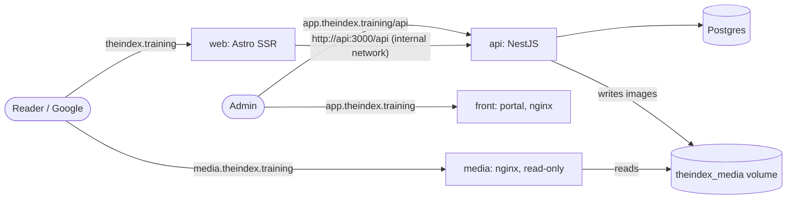

# Decision record: public site and articles

The reference for building the public site of The Index (`theindex-web`) and the content features it needs in `theindex-api` and `theindex-front`. It records what was decided, why, and what the first version (MVP) contains. Update it when a decision changes; don't let the code and this file disagree.

- **Status:** agreed, MVP not started
- **Decided:** 2026-11-05
- **Repos:** `theindex-web` (this repo, public site), `theindex-api` (data and endpoints), `theindex-front` (back office), `theindex-dev` (Docker templates; may become `theindex-infra`)

## 1. Context

The Index runs a gym portal (Angular SPA + NestJS API + Postgres) on `theindex.training`. We want a public journal of articles, in the spirit of [CrossFit Journal](https://journal.crossfit.com/) and [CrossFit Essentials](https://www.crossfit.com/essentials), that ranks in Google search.

Constraints that shaped the decisions:
- The content is public. Readers never log in.
- SEO matters: Google must receive real HTML with per-page metadata. The portal is a client-rendered SPA, so Google sees an empty shell.
- Same look and feel as the portal ("Chalk & Iron" design system).
- Content creators are not technical. They need a WordPress-like experience.
- One database and one API: later, the API sends weekly digest emails built from the articles, to trainees with accounts and to subscribers.
- Bulgarian only for now, with room for more languages.
- Videos live on YouTube. Images are self-hosted.
- No new paid providers for the MVP. Hosting stays on Contabo (VPS), DNS on Spaceship, routing on Traefik.

## 2. Decisions

| # | Decision | Why |
|---|---|---|
| D1 | No WordPress or headless CMS. Content is built into our own API and back office. | The needs are a small subset of a CMS; one database and one set of accounts. |
| D2 | **Public site: a new Astro app** (`theindex-web`), server-rendered on Node. | Built for content: HTML with no framework JavaScript by default, islands for the few interactive parts, server rendering, sitemap and RSS packages. Angular SSR was the alternative; it ships and hydrates the Angular runtime for pages that are just text. |
| D3 | **Server-rendered on every request, with HTTP cache headers.** No rebuild to publish. | Publishing and unpublishing take effect at once. Traffic is low, so no shared cache in the MVP; the headers make a CDN a drop-in later. |
| D4 | **Content management lives in the portal** (`theindex-front`), under `/content`, with its own WordPress-like layout. | The portal becomes "The Index back office". Auth, roles, i18n, design system, tests and CI already exist. A separate back-office app was rejected as unneeded complexity. |
| D5 | **MVP: only ADMIN manages content.** No new role, no account management changes. | Keeps the API change small. Content writers, account management and display names are designed together in phase 2. |
| D6 | **Articles are stored as Editor.js JSON blocks**, not HTML. | Block editor close to WordPress's Gutenberg. The same blocks render to the site now and to digest emails later. Raw editor HTML never reaches readers. |
| D7 | **Domains:** public site on `theindex.training`, portal on `app.theindex.training`, images on `media.theindex.training`. | Clear separation. Losing old bookmarks, stored sessions, theme and language choices is accepted (few users). |
| D8 | **URLs:** `/articles/<slug>`, `/articles/category/<slug>`, later `/movements/<slug>`. Slugs are always Latin, transliterated from the Bulgarian title. | Readable, shareable links (Cyrillic turns into `%D0%BA…` when pasted). |
| D9 | **Images on the VPS** in a Docker volume, served by a small nginx container. Processed by the API (resize, WebP, EXIF stripped). Behind a storage interface. | About 200 MB a year; no new provider. Moving to object storage later means a new storage implementation, a one-time copy and a DNS change. |
| D10 | **Videos are YouTube embeds**, loaded only when the reader clicks play. | No video hosting. YouTube's player and cookies load only on request, and pages stay fast. |
| D11 | **Byline is a fixed "Екипът на The Index"** on every article. The owning account is stored but never shown. | Display names come in phase 2. Never show an email on the public site. |
| D12 | **Categories only, no tags.** Many categories per article, managed by admins. | Tags make duplicates and thin pages at 4–10 articles a month. Movements will later play the role of tags. |
| D13 | **Analytics in phase 2** (cookieless, free tier, most likely Umami). **Google Search Console at launch.** | No cookie banner, no cost. Search Console is how we see Google search performance and needs no script. |
| D14 | **Bulgarian only, multi-language ready:** every article and category has a `language`; articles have an optional `translationGroupId`. | Other languages later under a prefix (`/en/articles/...`), with `hreflang` links between versions. |

## 3. Architecture



- Traefik routes each host to its container and gets Let's Encrypt certificates by itself (HTTP challenge).
- The site calls the API over the internal Docker network only, so there is no CORS and no public hop.
- The portal keeps calling the relative `/api` on its own host, so its code doesn't change for the move to `app.`.

## 4. URLs and slugs

| Path | Page | Notes |
|---|---|---|
| `/` | Home | Featured article (the newest published one in the MVP) and the latest articles |
| `/articles` | All articles, newest first | `?page=2…`; `?q=` for search (search results are `noindex`) |
| `/articles/<slug>` | Article | 404 unless published |
| `/articles/category/<slug>` | Category | 404 when it has no published articles |
| `/preview?token=…` | Draft preview | `noindex`, `no-store`; token from the back office, short-lived |
| `/sitemap.xml`, `/rss.xml`, `/robots.txt` | | Generated from the API on request |
| `/login` | 301 to `https://app.theindex.training/login` | Only old portal path we keep |

**Slug rules** (articles and categories; one implementation in the API, `*.spec.ts` next to it):
- Generated from the title (or category name) with the official Bulgarian transliteration (Streamlined System, Закон за транслитерацията 2009):

  | а | б | в | г | д | е | ж | з | и | й | к | л | м | н | о | п | р | с | т | у | ф | х | ц | ч | ш | щ | ъ | ь | ю | я |
  |---|---|---|---|---|---|---|---|---|---|---|---|---|---|---|---|---|---|---|---|---|---|---|---|---|---|---|---|---|---|
  | a | b | v | g | d | e | zh | z | i | y | k | l | m | n | o | p | r | s | t | u | f | h | ts | ch | sh | sht | a | y | yu | ya |

  Exception: `ия` at the end of a word becomes `ia` (София → sofia).
- Lowercase; Latin letters and digits kept; everything else becomes `-`; repeated `-` collapsed and trimmed; at most 80 characters, cut at a word boundary.
- Examples: "Как да започнем с КросФит" → `kak-da-zapochnem-s-krosfit`; "Защо клековете са важни?" → `zashto-klekovete-sa-vazhni`.
- Unique per language. On a clash, add `-2`, `-3`… Reserved for articles: `category`.
- An admin can edit the slug (Latin `a-z`, `0-9`, `-` only) **until the first publish; after that it is fixed**, so shared links never break. Changing published slugs, with redirects, is phase 2.
- A category slug is editable until a published article uses the category.

## 5. Article lifecycle and permissions

| State | Public site | Admin can |
|---|---|---|
| `DRAFT` (never published) | 404 | Edit, preview, publish, **delete permanently** (with confirmation) |
| `PUBLISHED` | Visible | Edit the working copy, preview, "Update" (publish the changes), discard changes, **unpublish** (with confirmation) |
| `UNPUBLISHED` (was published) | 404, so Google drops it | Edit, preview, republish, **delete permanently** (with confirmation) |

- Unpublish and permanent delete are both dangerous and both ask for confirmation. Permanent delete is refused for a published article: unpublish first.
- **Working copy:** autosave writes only to the article's draft. The published version changes only on Publish/Update. Without this, autosave would push half-written text to the live site.
- **Ownership:** each article stores `createdByAccountId` and `updatedByAccountId`. In the MVP they are informational (every admin can edit every article). **Deleting an account never deletes articles:** account delete is already a soft delete (status `DISABLED`), and the foreign keys use `ON DELETE SET NULL` in case a hard delete ever exists.
- **Phase 2:** a `CONTENT_WRITER` role who edits and deletes only their own articles, while admins keep access to all.

## 6. Data model (theindex-api)

New tables only; nothing existing changes. `synchronize` adds them (no migrations).

**`articles`**

| Column | Type | Notes |
|---|---|---|
| `id` | uuid | |
| `language` | varchar(8), default `bg` | |
| `translationGroupId` | uuid, null | Links versions of the same article in different languages (later) |
| `status` | enum `DRAFT` / `PUBLISHED` / `UNPUBLISHED` | |
| `slug` | varchar(80) | Unique with `language` |
| `title`, `excerpt`, `content` (jsonb), `featuredMediaId`, `seoTitle`, `seoDescription` | | **Published version.** Empty until the first publish. |
| `plainText` | text | Derived from `content` on publish: search, description fallback, digest emails |
| `draft` | jsonb | **Working copy:** `{ title, excerpt, content, featuredMediaId, categoryIds, seoTitle, seoDescription }` |
| `draftRevision` | int | Incremented on every draft save; used to detect two tabs editing at once (409) |
| `hasUnpublishedChanges` | boolean | Draft differs from the published version |
| `firstPublishedAt`, `lastPublishedAt`, `unpublishedAt` | timestamptz, null | `datePublished` / `dateModified` for SEO |
| `createdByAccountId`, `updatedByAccountId` | uuid, null, FK `accounts` `ON DELETE SET NULL` | |
| `createdAt`, `updatedAt` | timestamptz | |

**`article_categories`**: `id`, `language`, `name`, `slug` (unique with `language`), `description` (optional; category page intro and meta description), `sortOrder`, timestamps.
**`article_category_links`**: `articleId` + `categoryId` (`ON DELETE CASCADE` both ways). It holds the **published** categories; the draft holds `categoryIds`. Deleting a category removes its links and drops it from drafts' `categoryIds`; the articles stay.

**`media`**

| Column | Notes |
|---|---|
| `id` | uuid, also the folder name: files are never overwritten, so they can be cached forever |
| `altText` | Required. Describes the image for screen readers and Google |
| `width`, `height` | Of the stored master |
| `variants` | jsonb: `[{ width, height, path }]`, WebP at 480 / 960 / 1600 / 2400 px (only up to the original width) |
| `ogPath` | 1200×630 JPEG crop, used when it is a featured image (social previews) |
| `originalFilename`, `sizeBytes`, `uploadedByAccountId` (`SET NULL`), `createdAt` | |

Captions are not on `media`: they live on the image block, because the same photo can have different captions in different articles. The featured image has no caption.

## 7. Content format (Editor.js)

Allowed blocks in the MVP. The API rejects any other type (400) and normalizes what it stores:

| Block | Stored as | Rendered as |
|---|---|---|
| Paragraph | `{ text }` with inline `<b>`, `<i>`, `<a href>` | `<p>` |
| Heading | `{ text, level: 2 \| 3 }` (the title is the only `h1`) | `<h2>`/`<h3>` |
| List | `{ style: ordered \| unordered, items }` | `<ol>`/`<ul>` |
| Quote | `{ text, caption }` | `<blockquote>` + `<cite>` |
| Image | `{ mediaId, caption }`, normalized from the image tool's output; the file URL is ignored | `<figure>` with `` and `<figcaption>` |
| YouTube | `{ videoId, caption }`, parsed from the URL; the client's embed URL is never trusted | Thumbnail button; on click, an iframe from `youtube-nocookie.com` |
| Delimiter | `{}` | `<hr>` |

- Inline HTML is sanitized with an allowlist (`b`, `i`, `a[href]`, `br`; links only `http`, `https`, `mailto`) when the API saves, and again when the site renders.
- Editor.js's own output wrapper (`{ time, blocks, version }`) is kept, so the editor can load it back unchanged.
- The JSON body limit goes from Express's default 100 kB to 1 MB (a change in `main.ts`).

## 8. API changes (theindex-api)

All admin endpoints: `@UseGuards(JwtAuthGuard, RolesGuard)`, `@Roles(AccountRole.ADMIN)`. Public endpoints live under a separate `/api/public/...` prefix in their own controllers, so a missing guard can never expose drafts.

**Admin**
| Method and path | Purpose |
|---|---|
| `GET /api/articles?status&categoryId&search&page&pageSize` | Back-office list (draft title, status, `hasUnpublishedChanges`, dates) |
| `POST /api/articles` `{ title }` | Create a draft; generates the slug |
| `GET /api/articles/:id` | Full article: published version and draft |
| `PATCH /api/articles/:id/draft` `{ baseRevision, …fields }` | Autosave. 409 if `baseRevision` is stale |
| `POST /api/articles/:id/publish` | Validate and copy the draft over the published version (first publish and "Update") |
| `POST /api/articles/:id/unpublish` | `PUBLISHED` → `UNPUBLISHED` |
| `POST /api/articles/:id/discard-draft` | Reset the draft to the published version |
| `DELETE /api/articles/:id` | Permanent; 409 when `PUBLISHED` |
| `POST /api/articles/:id/preview-token` | Signed token, 30 minutes, for `/preview` on the site |
| `GET/POST/PATCH/DELETE /api/article-categories[/:id]` | Category management |
| `POST /api/media` (multipart: `file`, `altText`) | Upload: JPEG, PNG or WebP, up to 15 MB, checked by decoding (not by extension). Auto-rotate, strip EXIF (phone photos carry GPS), make variants |
| `GET /api/media?page&pageSize`, `GET /api/media/:id`, `PATCH /api/media/:id` `{ altText }` | Media library. No delete in the MVP (articles may use the image) |

**Public (no auth, published content only)**
| Method and path | Purpose |
|---|---|
| `GET /api/public/articles?category&q&page&pageSize` | Summaries, newest first. `q` searches title, excerpt and text with `ILIKE` (Postgres has no Bulgarian full-text config; fine at this size) |
| `GET /api/public/articles/:slug` | Article with blocks, image variants resolved to URLs, categories |
| `GET /api/public/article-categories` | Categories with at least one published article |
| `GET /api/public/article-categories/:slug` | One category |
| `GET /api/public/sitemap` | Slugs and `lastmod` for articles and categories |
| `GET /api/public/preview?token=` | Draft rendered for preview |

- Lists return `{ items, total, page, pageSize }` (page size up to 50).
- **Publish validation:** title 1–200 characters, valid unique slug, at least one block, excerpt up to 300, SEO title up to 70, SEO description up to 160, existing categories and featured image. Draft saves validate structure only, so incomplete work can always be saved.
- **New config** (`.env.example`): `MEDIA_STORAGE_DIR` (`/data/media`), `MEDIA_PUBLIC_URL` (`https://media.theindex.training`), `MEDIA_MAX_UPLOAD_MB` (15).
- **New dependencies:** `sharp` (prebuilt for Alpine), `sanitize-html`. Uploads use the multer that `@nestjs/platform-express` already ships.
- Tests follow the API's rules: specs for the slug, block normalization and sanitizer utils; `*.int-spec.ts` against Postgres for the services (lifecycle, permissions, 409s, `SET NULL`, search); e2e for the public endpoints.

## 9. Back office (theindex-front)

- **Routes** (`roleGuard`, `data.roles: ['ADMIN']`), lazy-loaded so the editor never touches the initial bundle:
  - `/content/articles`: list with a status filter and search, plus "New article".
  - `/content/articles/:id`: the editor. "New article" creates the draft first and opens it here.
  - `/content/categories`: list, create, edit and delete.
- **Editor layout (WordPress-like, full screen):**
  - Top bar: back, save status ("Запазено" / "Запазва се…" / error), Preview, Publish or Update.
  - Main column: title, then Editor.js.
  - Right panel: status, slug, excerpt, categories, featured image, SEO title and description, and at the bottom Unpublish / Delete permanently (each with a confirmation dialog).
- **Autosave:** about 2 seconds after the last change, and when leaving the page. On a 409, the page tells the admin the article changed in another tab and offers to reload.
- **Media picker:** a dialog to upload (alt text required) or choose from the library. Used by the featured image and the image block.
- **Preview:** opens `https://theindex.training/preview?token=…` in a new tab. New environment value `publicSiteUrl`.
- **Navigation:** a "Съдържание" item in the Manage group, admins only. A URL-only area and the content-writer redirect on login are phase 2 decisions.
- The portal's rules apply as usual: all text in `bg.json` and `en.json`, `ARTICLE_STATUS` enum labels, design tokens only (Editor.js's default styles need overrides for dark mode), `Eager` change detection, characterization-test rules for new logic.

## 10. Public site (theindex-web)

- **Stack:** current stable Astro with the Node adapter (standalone server), TypeScript strict, `astro check`, ESLint + Prettier set up like the other repos, Vitest for logic, Playwright for journeys. The site renders on the server, so E2E runs against a small stub API server, not `page.route`.
- **Design:**
  - Copy the tokens and the global classes the site needs from `theindex-front/src/styles.scss`, which stays the source of truth.
  - Fonts: Sofia Sans and Sofia Sans Condensed, **self-hosted** (Fontsource, Cyrillic subsets), not loaded from Google's servers, for speed and GDPR.
  - Theme: light, dark or system, with the same pre-paint inline script and the same `theme` key. It's a separate origin, so it's a separate choice.
  - Logo from `public/brand/` of the portal.
- **Layout:**
  - Header: logo, "Статии", the categories, and "Вход" linking to `https://app.theindex.training`.
  - Footer: © The Index. No address, since there is more than one gym.
- **Interactivity (islands):** the theme switch and the YouTube player only.
- **i18n:** Astro i18n with `defaultLocale: 'bg'` and no prefix. UI text lives in translation files from day one. Dates are formatted for `bg` in `Europe/Sofia`.
- **SEO on every page:**
  - `<title>` ("<title> | The Index"), meta description (SEO description, excerpt or the start of the text), absolute canonical URL, `<html lang="bg">`.
  - Open Graph and Twitter card, using the featured image's 1200×630 crop or a default site image.
  - JSON-LD: `Article` (headline, image, dates, author and publisher: the organization "The Index") plus `BreadcrumbList`; `WebSite` on the home page.
  - Sitemap, RSS and `robots.txt`.
  - The featured image on the article page loads eagerly with `fetchpriority="high"`, because it is the largest element on screen and Google times it.
- **Cache headers:**
  - HTML: `public, max-age=60, stale-while-revalidate=300`, so an unpublish is visible within about a minute.
  - Hashed assets: one year, `immutable`. Media (set by the media container): one year, `immutable`.
  - Preview: `no-store` + `X-Robots-Tag: noindex`.
- **API down:** a 503 page with a retry, never a stack trace.
- **Config:** `API_INTERNAL_URL` (`http://api:3000/api`), `SITE_URL` (`https://theindex.training`), `APP_URL` (`https://app.theindex.training`). Image URLs come from the API.
- **Docker:** `node:24-alpine` multi-stage, port 4321. CI: lint, check, tests, build, E2E; on `main`, build the image to GHCR and redeploy over SSH, like the other repos. The workflow needs the owner's approval before it's added.

## 11. Infrastructure

Current state (2026-11-05): `/opt/theindex/docker-compose.yml` on the Contabo VPS with `traefik` (v3.6.1, Let's Encrypt HTTP challenge, www → apex redirect), `db`, `api` (`theindex.training/api`) and `front` (rest of `theindex.training`; image hard-coded instead of `${FRONT_IMAGE}`). Each repo's deploy job runs `docker compose pull && docker compose up -d` for the whole stack.

**Target labels and services** (sketch; the final file is written during the cutover):

```yaml
  api:
    # ...as today, plus:
    volumes:
      - theindex_media:/data/media
    labels:
      - traefik.http.routers.api.rule=Host(`app.theindex.training`) && PathPrefix(`/api`)
      # CORS_ORIGIN=https://app.theindex.training in .env

  front:
    image: ${FRONT_IMAGE}
    labels:
      - traefik.http.routers.front.rule=Host(`app.theindex.training`) && !PathPrefix(`/api`)

  web:
    image: ${WEB_IMAGE}
    environment:
      - API_INTERNAL_URL=http://api:3000/api
      - SITE_URL=https://theindex.training
      - APP_URL=https://app.theindex.training
    labels:
      - traefik.http.routers.web.rule=Host(`theindex.training`)
      - traefik.http.services.web.loadbalancer.server.port=4321

  media:
    image: nginx:alpine
    volumes:
      - theindex_media:/usr/share/nginx/html:ro
      - ./media/default.conf:/etc/nginx/conf.d/default.conf:ro  # cache headers, nosniff
    labels:
      - traefik.http.routers.media.rule=Host(`media.theindex.training`)

volumes:
  theindex_media:
```

Every router keeps its `-http` twin with the HTTPS redirect, `entrypoints`, `tls.certresolver=le` and `traefik.docker.network=theindex_internal`, as today.

**Cutover order** (certificates are requested over HTTP, so DNS must resolve first or Let's Encrypt fails and rate-limits):
1. Spaceship DNS: add `A` records `app` and `media` with the same IP as `@`. Wait until they resolve.
2. Compose phase A: `api` and `front` answer on **both** `theindex.training` and `app.theindex.training` (`Host(...) || Host(...)`). Add the media volume and container. Use `${FRONT_IMAGE}`. Check `app.theindex.training` end to end.
3. Ship the API and back-office work. Admins write the first articles on `app.`.
4. Compose phase B: `theindex.training` → `web`. `front` and `api` keep only `app.`. Set the portal's `publicSiteUrl`.
5. Google Search Console: verify the domain with a TXT record in Spaceship and submit `https://theindex.training/sitemap.xml`.

**Backups:** Contabo's daily instance backups include the database and the media volume. A nightly `pg_dump` is recommended on top (a snapshot of a running Postgres isn't guaranteed to restore cleanly). **Never print or share `traefik/acme.json`**: it holds the certificates' private keys.

## 12. MVP backlog (in order)

Each item is roughly one PR. API items come first because the other two repos depend on them; the site scaffold can start in parallel against a stub API.

| # | Repo | Item | Depends on |
|---|---|---|---|
| 1 | web | Scaffold: Astro, tokens, fonts, layout, header/footer, theme switch, lint/format/tests, Dockerfile, `CLAUDE.md` | |
| 2 | web | CI workflow (needs the owner's approval) | 1 |
| 3 | api | Slug transliteration util | |
| 4 | api | Media: upload, processing, storage, library | |
| 5 | api | Article categories: admin CRUD and public endpoints | 3 |
| 6 | api | Articles: entity, draft and lifecycle, block validation and sanitizing, admin endpoints | 3, 4, 5 |
| 7 | api | Public articles, search, sitemap feed, preview tokens | 6 |
| 8 | infra | DNS records, compose phase A | |
| 9 | front | `/content` area, navigation, categories pages | 5 |
| 10 | front | Article list and editor: Editor.js, autosave, settings panel, media picker | 6 |
| 11 | front | Publish, update, unpublish, delete (with confirmations), preview | 7, 10 |
| 12 | web | Article page: block renderer, SEO head, JSON-LD, YouTube player | 1, 7 |
| 13 | web | Home, article list, category pages, pagination, search | 12 |
| 14 | web | Sitemap, RSS, robots, 404/503, `/login` redirect, preview route | 12 |
| 15 | infra | Compose phase B, Search Console | 8, 11, 14 |

## 13. Phase 2 and later

- `CONTENT_WRITER` role, account management in the portal, display names, author bylines and pages, "own articles only" permissions; whether writers get a URL-only back office with a redirect on login.
- Revisions (snapshot on every publish, restore into the draft).
- Analytics (cookieless; Umami free tier is the default).
- Subscribers and weekly digest emails (rendered by the API from the blocks).
- Comments (readers with accounts).
- Movements library (`/movements`), shared with the portal (records, trainings), and movement blocks in articles.
- Changing published slugs with redirects; a "featured" flag for the home page; other languages; media delete and cleanup; a CDN in front; nightly `pg_dump`; versioning the compose file (`theindex-dev`).

## 14. Open points (defaults in use until decided)

- **Home featured article:** the newest published article. A manual "featured" flag is phase 2.
- **Categories in the header:** all categories with published articles, in `sortOrder`. If the list grows too long, show a "Categories" menu instead.
- **Reading time** on article cards ("5 мин четене"): not in the MVP unless asked for.
